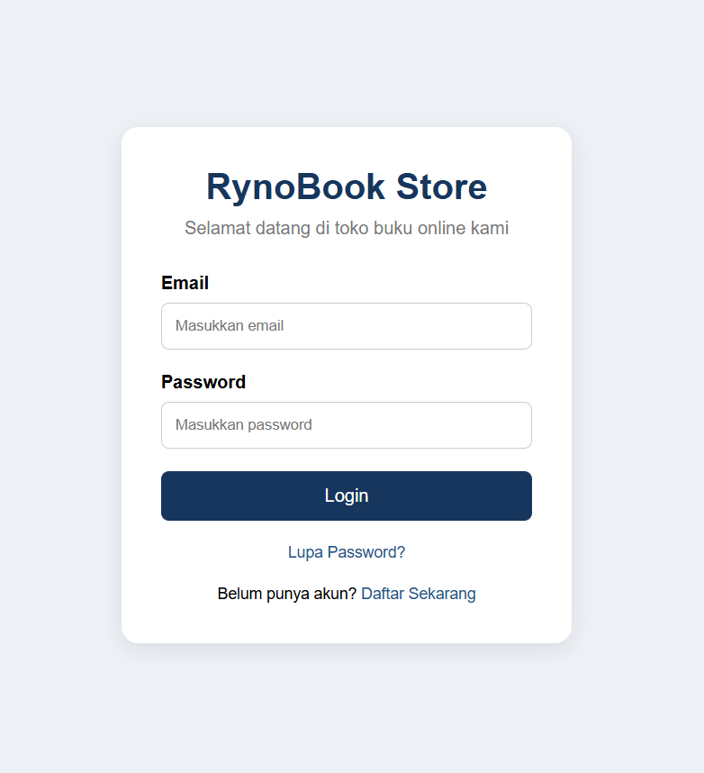
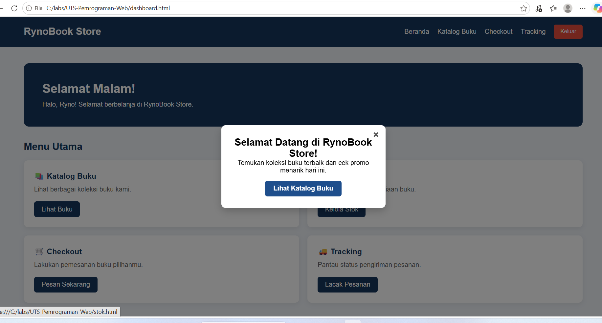
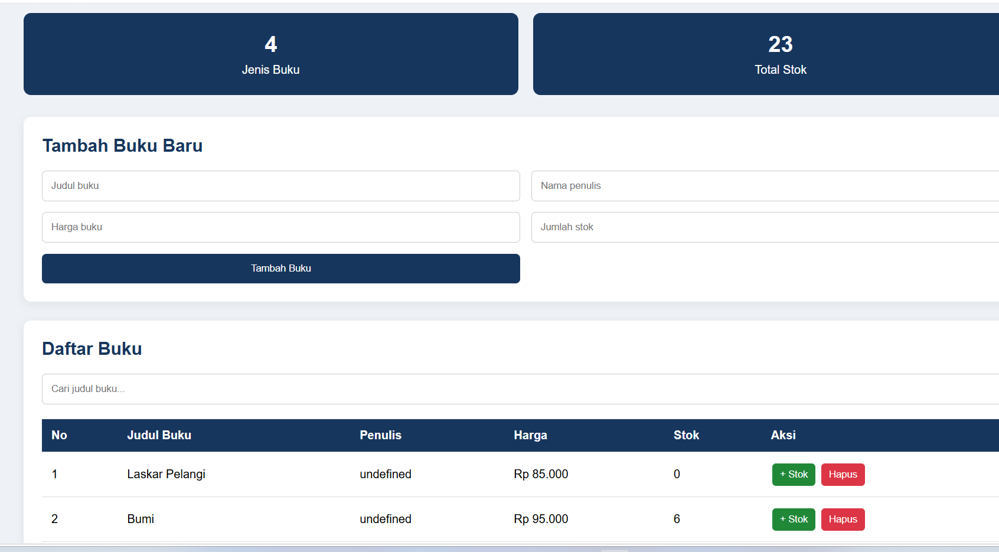
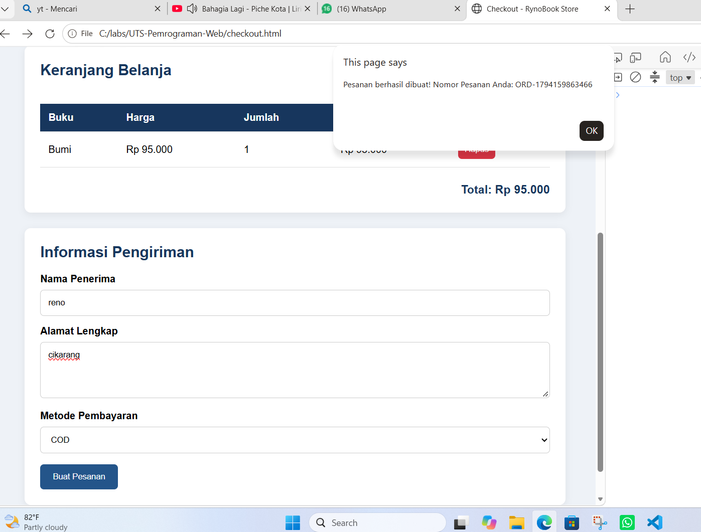
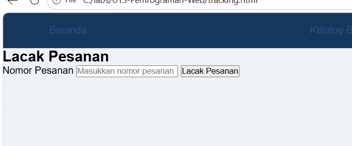
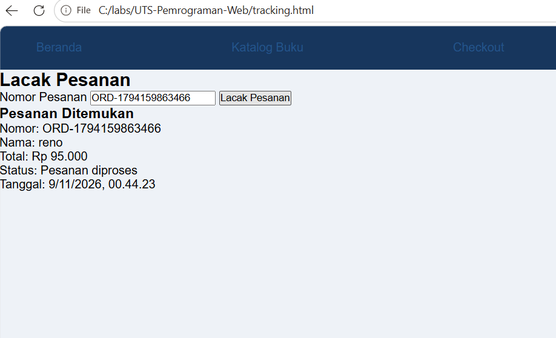
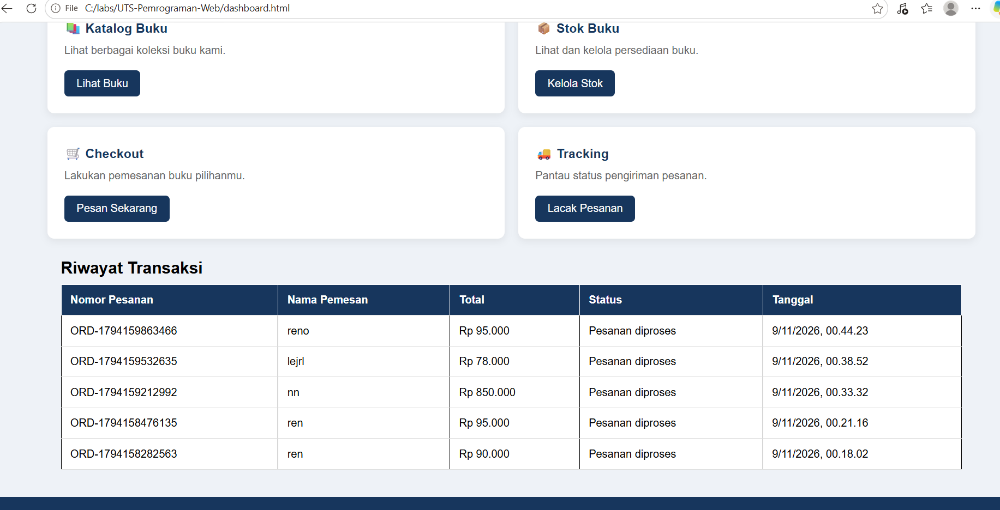

RynoBook Store

1. Informasi Project

- Nama Project: RynoBook Store
- Mata Kuliah: Pemrograman Web 
- Nama: Muhammad Ryno Al Faridz
- NIM: 312510022
- Kelas: 1253A

2. Deskripsi Project

RynoBook Store merupakan aplikasi toko buku online sederhana yang dibuat untuk memenuhi tugas UTS Pemrograman Web 1.

Aplikasi ini dibuat untuk membantu pengguna melihat katalog buku, melakukan pemesanan, dan memantau status pengiriman pesanan.

Project ini menggunakan HTML, CSS, dan JavaScript. Penyimpanan data dilakukan menggunakan localStorage pada browser.

3. Tujuan Project

- Menerapkan HTML untuk membuat struktur website.
- Menggunakan CSS untuk mengatur tampilan website.
- Menggunakan JavaScript untuk membuat fitur interaktif.
- Menerapkan manipulasi DOM dan validasi formulir.
- Menggunakan localStorage untuk menyimpan data.

4. Teknologi yang Digunakan

- HTML
- CSS
- JavaScript
- LocalStorage
- Visual Studio Code

5. Fitur Aplikasi

1. Login pengguna.
2. Dashboard dan navigasi.
3. Katalog dan pengelolaan stok buku.
4. Checkout atau pemesanan buku.
5. Tracking pengiriman.
6. Laporan pemesanan.
7. History transaksi.

6. Struktur Folder

RynoBook-Store/
├── login.html
├── dashboard.html
├── stok.html
├── checkout.html
├── tracking.html
├── README.md
├── css/
│   └── style.css
├── js/
│   ├── data.js
│   └── script.js
├── assets/
└── docs/
    └── screenshots/

## Dokumentasi Screenshot

### 1. Login

### 2. Dashboard

### 3. Katalog Buku

### 4. Checkout

### 5. Tracking

### 6. Laporan Pemesanan

### 7. History Transaksi
